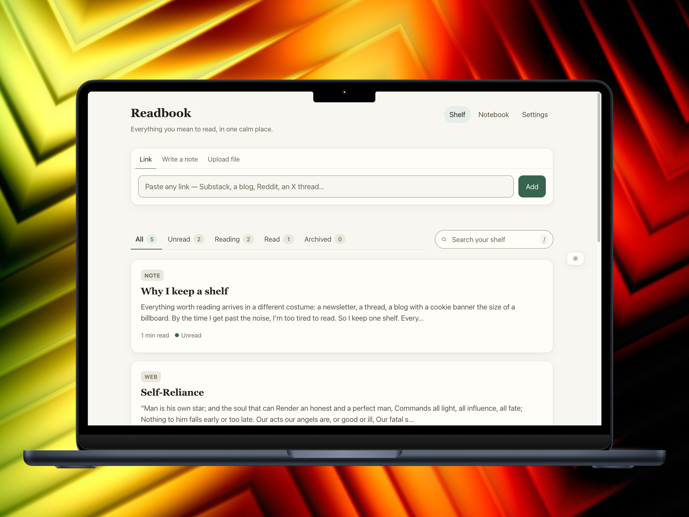
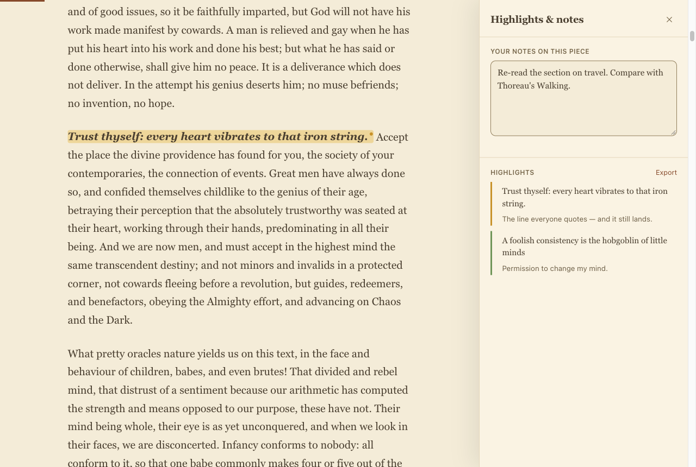
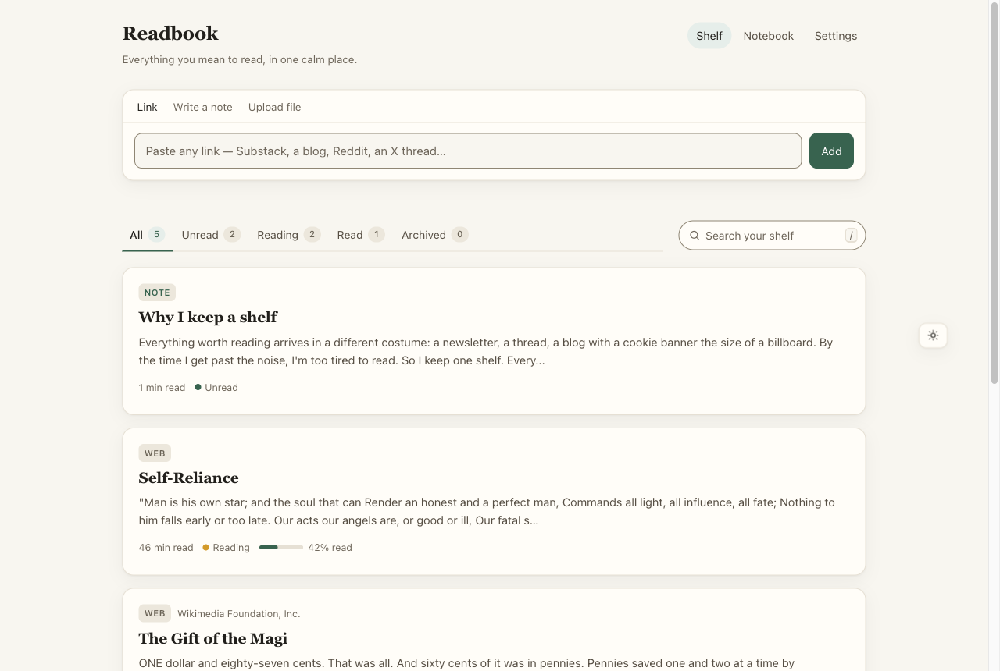
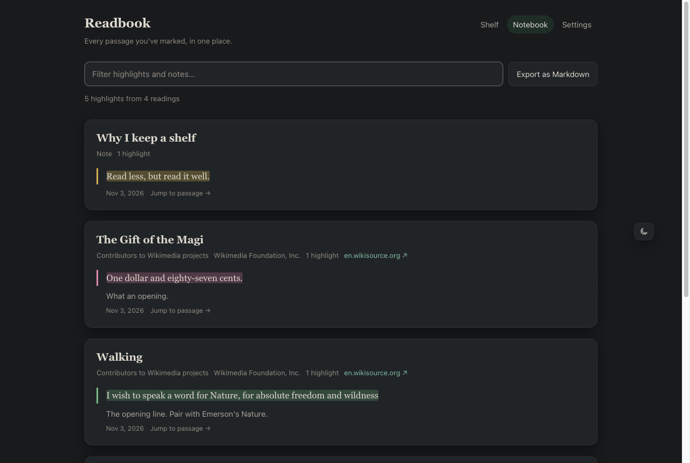
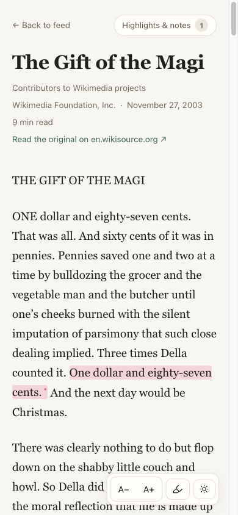
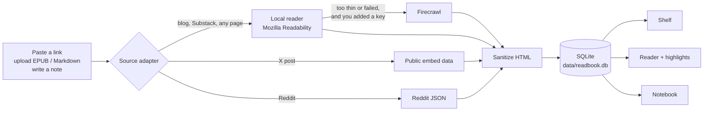

<p align="center">
  <picture>
    <source media="(prefers-color-scheme: dark)" srcset="docs/assets/wordmark-dark.svg">
    
  </picture>
</p>

<p align="center"><strong>A calm, local-first read-it-later.</strong><br>
Paste any link — a newsletter, a blog post, a thread — and read it like a book.</p>

<p align="center">
  <a href="LICENSE"></a>
  <a href="https://github.com/Raandino/readbook/actions/workflows/ci.yml"></a>
  
  
</p>

<p align="center">
  
</p>

---

There is more worth reading than ever, and almost all of it arrives in a different costume:
an inbox full of newsletters, a blog with a cookie banner the size of a billboard, a thread
buried in an app designed to keep you scrolling. By the time you get past the noise, your
brain is tired, and the colors, the typography, the clutter all make it worse.

**Readbook gives everything you mean to read one quiet home.** Every link, whatever its
origin, is cleaned up and reshaped into the same book-like page — a warm serif at a
comfortable line length, a light, sepia or dark theme that suits the hour — and waits on a
shelf that is only yours. No accounts, no feed algorithm, no ads. It runs on your computer and
your library is a single file you own.

## Readbook is for you if

- ✅ You save more articles than you read and want **one place** for all of them
- ✅ You want reading to feel like a **book**, not a web page
- ✅ You **highlight and annotate** what you read and want those notes to stay yours
- ✅ You'd rather **own your data** in a local file than rent it from a service
- ✅ You're comfortable running `pnpm install` (a one-click app is on the roadmap)

## Features

<table>
<tr>
<td width="50%" valign="top">

### 📚 One shelf for everything
Paste a link from a blog, Substack, Reddit, X or any page; upload an **EPUB** or
**Markdown** file; or **write a note** yourself. Everything lands as the same clean reading.
Filter by *Unread / Reading / Read / Archived* and search titles and full text.

</td>
<td width="50%" valign="top">

### 📖 A reader built for long attention
Warm serif, ~66-character measure, generous leading, three themes (light, sepia, dark),
adjustable text size, and **resume exactly where you stopped**. A thin progress bar, nothing
else.

</td>
</tr>
<tr>
<td valign="top">

### 🖍️ Highlights & notes
Select a passage, pick one of four colors (or press <kbd>H</kbd>), and add a note in the
margin. Keep a running note on the whole piece. Highlights are anchored to the text itself, so
they survive re-rendering.

</td>
<td valign="top">

### 🗒️ Notebook
Every passage you've marked, across your whole shelf, in one searchable page. **Export to
Markdown** for Obsidian, Notion or wherever your notes live.

</td>
</tr>
<tr>
<td valign="top">

### 🧹 Clean extraction
A fast local reader (Mozilla Readability) does the work for free. For JavaScript-rendered
pages it can fall back to [Firecrawl](https://www.firecrawl.dev), **only if you add your own
key**. Every article is sanitized before it's stored.

</td>
<td valign="top">

### 🔒 Private and safe by default
Your shelf is a local SQLite file. The server listens on `localhost` only, refuses
cross-site requests and DNS rebinding, blocks links to private networks (SSRF), and ships a
strict Content-Security-Policy. See [SECURITY.md](SECURITY.md).

</td>
</tr>
<tr>
<td valign="top">

### ⚙️ Settings in the browser
No `.env` editing required: add a Firecrawl key, choose the User-Agent, and manage your
data from the **Settings** page. Keys are never sent back to the browser.

</td>
<td valign="top">

### 💾 Backup & restore
Download your whole library (readings, progress, notes, highlights) as one JSON file and
restore it anywhere. Restores merge, so they're safe to run twice.

</td>
</tr>
</table>

<p align="center">
  
</p>

<p align="center">
  
</p>

<p align="center">
  
  &nbsp;
  
</p>

<p align="center"><sub>Screenshots show public-domain texts from Wikisource and Project Gutenberg.</sub></p>

## Quick start

### The easy way: ask your AI assistant

Not a developer? Copy this sentence into an AI agent that can run commands on your computer
(Claude Code, Codex, Cursor, Windsurf…):

```text
Install Readbook for me by following https://raw.githubusercontent.com/Raandino/readbook/main/prompt.md
```

[`prompt.md`](prompt.md) walks the agent through everything in plain language: it checks
your computer, asks before installing anything, starts Readbook, gives you a short tour, and
can put a double-click launcher on your Desktop.

### By hand

You need **[Node.js 22.12+](https://nodejs.org)** and **pnpm** (`corepack enable` installs the
right version for you).

```sh
git clone https://github.com/Raandino/readbook.git
cd readbook
pnpm install
pnpm run setup     # checks your toolchain and creates .env + data/ (safe to re-run)
pnpm dev           # → http://localhost:4321
```

Open <http://localhost:4321>, paste a link, and start reading. That's it. The database is
created on first run at `data/readbook.db`.

> [!NOTE]
> Use `pnpm run setup` and `pnpm run doctor` (with `run`). Bare `pnpm setup` and
> `pnpm doctor` are pnpm's own built-in commands.

<details>
<summary><strong>Run it like an app (production build)</strong></summary>

```sh
pnpm start         # builds, then serves on http://localhost:4321
PORT=8080 pnpm start
```

</details>

<details>
<summary><strong>Run it with Docker</strong></summary>

```sh
docker compose up -d --build   # → http://localhost:4321
```

Your shelf lives in the `readbook-data` volume. The port is published on `127.0.0.1` only.
The Docker image is new and has not been tested on every platform yet. Please open an issue if it gives you trouble.

</details>

<details>
<summary><strong>Something not working?</strong></summary>

```sh
pnpm run doctor    # read-only diagnostics: versions, .env, database path, port
```

`better-sqlite3` is a native module. If it fails to install, make sure you're on a supported
Node version, and that build tools are available (Xcode Command Line Tools on macOS,
`build-essential` + `python3` on Linux).

</details>

## Configuration

Everything is optional. Most people only ever touch the **Settings** page. Values saved there
override environment variables, which override the defaults.

| Setting | Settings page | Environment variable | Default |
| --- | :---: | --- | --- |
| Firecrawl API key (fallback for JS-rendered pages) | ✅ | `FIRECRAWL_API_KEY` | not set: local reader only |
| Firecrawl proxy mode (`basic` / `auto`) | ✅ | `READBOOK_FIRECRAWL_PROXY` | `basic` |
| User-Agent for page fetches | ✅ | `READBOOK_USER_AGENT` | `Mozilla/5.0 (compatible; Readbook/<version>; +<repo>)` |
| Allow links to private/LAN addresses | ✅ | `READBOOK_ALLOW_PRIVATE_NETWORK` | off |
| Database file | | `READBOOK_DB_PATH` | `./data/readbook.db` |
| Bind address / port (production) | | `HOST` / `PORT` | `localhost` / `4321` |
| Extra allowed hostnames | | `READBOOK_ALLOWED_HOSTS` | none (loopback only) |

See [`.env.example`](.env.example) for details on each.

### Reading from another device

Readbook has **no login**: anyone who can reach its port owns your shelf. That's why it only
listens on `localhost`. To read from your phone, the safest option is a private network like
[Tailscale](https://tailscale.com) or an authenticating reverse proxy. If you understand the
risk and trust your network, you can run `HOST=0.0.0.0 READBOOK_ALLOWED_HOSTS=192.168.1.20 pnpm start`
(using your computer's address).

## How it works



Every source is normalized into one shape, a **`Reading`** (title, author, site, lead image,
excerpt, clean HTML, plain text, reading time, status, progress). All network access goes
through one SSRF-guarded fetcher, and all HTML goes through one strict sanitizer before it is
stored.

| Package | What it does |
| --- | --- |
| [`apps/web`](apps/web) | Astro (server-rendered, Node adapter): pages, API routes, middleware, reader UI |
| [`packages/core`](packages/core) | The shared contract: `Reading`, `Highlight`, `ExtractOptions` |
| [`packages/db`](packages/db) | SQLite via Drizzle + better-sqlite3: schema, migrations, queries |
| [`packages/extractor`](packages/extractor) | Safe fetching, Readability/Firecrawl, source adapters, sanitizing, EPUB/Markdown import |

**Stack:** TypeScript (strict) · Astro 7 · SQLite (better-sqlite3 + Drizzle ORM) · Mozilla
Readability · linkedom · sanitize-html · Vitest · pnpm + Turborepo.

### Supported sources

| Source | How | Notes |
| --- | --- | --- |
| Any article or blog | Local reader | The workhorse. Free and fast. |
| Substack | Local reader | Custom-domain Substacks work as regular pages. |
| JavaScript-rendered pages | Firecrawl fallback | Only with your own Firecrawl key. |
| X (Twitter) posts | Public embed data | Single posts. X Articles show their public preview. Unofficial: may break. |
| Reddit posts | Reddit's `.json` view | Reddit often refuses unauthenticated requests. Official API support is on the roadmap. |
| EPUB / Markdown files | Upload | Read and highlight your own documents. |
| Your own writing | "Write a note" | Markdown supported. |

## What Readbook is not

- **Not a social network.** No followers, likes, or sharing; it's a shelf for one.
- **Not a paywall or login bypass.** It reads what a page shows publicly, nothing more.
- **Not a crawler.** It fetches a page only when you paste its link.
- **Not a cloud service.** There's no hosted version; your data never leaves your machine
  (except a URL sent to Firecrawl, if you enable it).

## Development

```sh
pnpm dev           # dev server with hot reload → http://localhost:4321
pnpm typecheck     # TypeScript + astro check
pnpm test          # unit tests (Vitest)
pnpm test:watch
pnpm build         # production build
pnpm check         # typecheck + format check + tests + build: what CI runs
pnpm db:studio     # browse your database in Drizzle Studio
```

Tests run against an in-memory database and never touch your shelf. Read
[CONTRIBUTING.md](CONTRIBUTING.md) before opening a pull request. It covers the few rules that
keep Readbook safe (sanitize all HTML, fetch only through `safeFetch`, no inline scripts).

## Roadmap

- [ ] Official Reddit API support
- [ ] Tags and collections
- [ ] RSS / newsletter auto-ingest
- [ ] Offline reading (PWA)
- [ ] One-click desktop app (macOS)
- [ ] Optional sync via Cloudflare Workers + D1

Ideas and feedback are welcome in [issues](https://github.com/Raandino/readbook/issues).

## Responsible use

Readbook is a personal tool. It fetches a page only when you paste its link and keeps a
private copy on your machine so you can read it later.

- **You are responsible for how you use it.** Many sites have terms of service, robots.txt
  rules and API policies that limit automated access. Before you save content from a site,
  check that doing so is allowed.
- **Personal use only.** Saved copies are for your own reading. Don't republish, share, sell
  or re-host them. Copyright stays with the authors. Use **Read the original** to visit and
  support the source.
- **Unofficial interfaces.** The X and Reddit adapters use public endpoints those platforms
  don't document. They may break without notice and are used under those platforms' terms.
  Firecrawl runs only with your own key, under your Firecrawl account terms.
- **Honest by default.** Readbook identifies itself with its own User-Agent and does not get
  around logins, paywalls or other access controls.

Substack, Reddit, X/Twitter, Firecrawl and Kindle are trademarks of their respective owners.
Readbook is an independent project, not affiliated with or endorsed by any of them.

## License

[MIT](LICENSE) © 2026 Rodolfo Andino and Readbook contributors.

Readbook stands on the shoulders of
[Mozilla Readability](https://github.com/mozilla/readability),
[Astro](https://astro.build), [Drizzle](https://orm.drizzle.team),
[better-sqlite3](https://github.com/WiseLibs/better-sqlite3),
[linkedom](https://github.com/WebReflection/linkedom) and
[sanitize-html](https://github.com/apostrophecms/sanitize-html). See
[THIRD_PARTY_NOTICES.md](THIRD_PARTY_NOTICES.md) for attributions. The licensing, provenance
and security review behind this release is documented in
[docs/open-source-review.md](docs/open-source-review.md).
